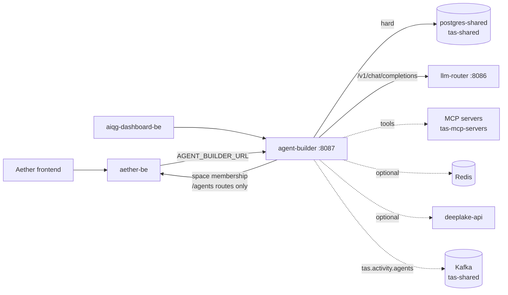

# TAS Agent Builder

*Verified against commit `c01f265` ("agent visibility private | organization | public (AB-13)", AB-13 being the platform backlog item that replaced the public flag with three sharing levels) on 2026-11-22. That commit is what runs in the cluster. Captures and observations that were not repeated keep their earlier date.*

## What this is

A Go service in the Tributary AI Services (TAS) platform that stores AI agent definitions and runs them. An agent here is a database row — a name, a system prompt, a model configuration, and a list of attached skills, a skill being a stored row that names a Model Context Protocol (MCP) server and the tool names it exposes. Calling `POST /api/v1/agents/:id/execute` turns that row plus the caller's input into a chat completion, sends it to the TAS LLM Router, and, when the model asks for a tool, calls out to an MCP server over HTTP, feeds the result back into the conversation, and loops until the model stops asking or the iteration cap (`MCP_MAX_TOOL_ITERATIONS`, 10 by default) is reached.

Since `acd03a7` the code also emits activity events: creating an agent or executing a user agent (one a person created, as opposed to the internal system agents seeded by migrations; both are defined under Status & scope) publishes a CloudEvents 1.0 message (the Cloud Native Computing Foundation's event-envelope format) to the Kafka topic `tas.activity.agents` (`events/publisher.go:44`). That is a side channel for other TAS services. It is not part of any HTTP response, and a failed publish does not fail the request. The deployed build has the publisher switched on; what has and has not been observed of it is under Status & scope.

Three things it is deliberately not. It is not a model gateway: every provider call goes to the TAS LLM Router at `{ROUTER_BASE_URL}/v1/chat/completions` (`services/impl/router_service_impl.go:93`), so this repository holds no OpenAI or Anthropic credentials and needs none. It is not a workflow engine — multi-step orchestration lives in aether-be (the Go backend of the Aether web application, and this service's main caller) and Argo Workflows, and an agent execution here is a single request-scoped tool loop. It is not an MCP host or federation gateway: it speaks plain HTTP to individual MCP servers in the `tas-mcp-servers` namespace, discovering tools with `GET {server}/mcp/tools/list` and invoking them with `POST {server}/mcp/tools/call` (`services/impl/mcp_context_impl.go:146`, `services/impl/mcp_context_impl.go:59`). It does not route through the prod-tas-mcp federation server (the TAS MCP gateway from the `tas-mcp` repository, which aggregates many MCP servers behind one endpoint).

"Agent" in this document means any row in `agent_builder.agents`; nothing is generated at runtime. User agents and internal agents call tools through the same loop, `executeWithToolLoop` (`handlers/agent_handlers.go:1923`), which offers the model the tools of the agent's attached skills and sends each call to that skill's server. The loop is used when `MCP_ENABLED` is on and the agent either has skills or uses the MCP context strategy; otherwise the agent answers without tools. The context strategy is the agent's `document_context.strategy` field, which chooses how documents reach the model (`vector`, `full`, `hybrid`, `mcp` or `none`, declared at `models/agent.go:168`); the value `mcp` is the one that switches the tool loop on (`handlers/agent_handlers.go:1216`). When the field is empty the strategy defaults by agent type and is never `mcp` (`handlers/agent_handlers.go:1479`). One difference: an internal-agent execute request may also name skills in `context.skill_ids`, and those replace the agent's own skills for that call (`handlers/agent_handlers.go:741`), although that route is broken today (see Status & scope). User-agent execution has no such override. An agent with no skills but the MCP strategy falls back to `MCP_SERVER_URL`. There is one exception to calling a skill's server directly: when a skill has both an `mcp_server_id` and an `mcp_connection_id`, the call goes through aether-be's MCP proxy at `AETHER_BE_MCP_URL` instead, so that it uses that user-authorized connection (`handlers/agent_handlers.go:2039`).

The five default skills seeded at startup, and the server each one calls, as written in `SeedDefaults` (`services/impl/skill_service_impl.go:270`):

| Skill | MCP server (`tas-mcp-servers`) | Seeded at |
|---|---|---|
| `visual_generation` | `http://napkin-mcp.tas-mcp-servers.svc.cluster.local:8087` | `services/impl/skill_service_impl.go:280` |
| `sequential_thinking` | `http://sequential-thinking-mcp.tas-mcp-servers.svc.cluster.local:8000` | `services/impl/skill_service_impl.go:295` |
| `paper_search` | `http://paper-search-mcp.tas-mcp-servers.svc.cluster.local:8000` | `services/impl/skill_service_impl.go:310` |
| `context7_docs` | `http://context7-mcp.tas-mcp-servers.svc.cluster.local:8000` | `services/impl/skill_service_impl.go:325` |
| `podcast_production` | `http://podcast-mcp.tas-mcp-servers.svc.cluster.local:8092` | `services/impl/skill_service_impl.go:340` |

On 2026-11-22 all five Services existed in `tas-mcp-servers` on exactly those ports. Seeding inserts a skill only when no row with that name exists and never updates one (`services/impl/skill_service_impl.go:351`), so the URL the cluster actually calls is whatever the database row holds, not necessarily the code.

Every user agent belongs to a *space* — Aether's tenancy boundary, identified by an opaque string such as `space_1766596584` — and since `892ff8f` (AB-5, the platform backlog item for enforcing space isolation in this service) every call under `/api/v1/agents`, apart from the `/internal` routes, must say which space it is acting in. This service holds no membership data, so it asks aether-be: the caller names the space in an `X-Space-ID` header (or a `space_id` query parameter), and the `spaceContextMiddleware` (`cmd/main.go:398`) calls `GET {aether-be}/api/v1/spaces/{id}/membership` with the caller's own bearer token (`services/impl/space_service_impl.go:120`). Only a space aether-be confirms is used to filter queries; the header is never trusted on its own. Reads then return the caller's own agents in that space, every internal agent, and whatever has been shared with the caller as described next (`services/impl/agent_service_impl.go:44`); writes — update, delete, publish, unpublish — match only the caller's own agent in that space (`services/impl/agent_service_impl.go:94`). The commit message for `892ff8f` records why: before it, any authenticated user could delete or rewrite any agent, including the sixteen seeded system agents, and the one existing `space_id` filter was typed as a UUID, which no real space ID is, so it rejected every real value with `400`.

Since `c01f265` (AB-13) sharing has three levels, held in each agent's `visibility` field (`models/agent.go:246`). Whoever can read an agent can also run it and duplicate it.

| `visibility` | Who can read it | Who can set it |
|---|---|---|
| `private` (default) | The owner, in the space it was created in | The owner |
| `organization` | Also anyone working in a space of the same Aether Organization | The owner, in a space that belongs to an Organization; otherwise `400` with code `visibility_organization_requires_org_space` |
| `public` | Every authenticated user of every Organization, from any space | The owner, with the `admin` realm role in their token (`PUBLIC_AGENT_ROLE` changes the role name); otherwise `403` with code `visibility_public_requires_admin` |

The Organization comes from the `organization_id` in aether-be's membership answer, is copied onto the agent when it is created or its visibility is written, and never matches when empty, so a caller in a personal space sees no organization-shared agents. The older `is_public` flag stays for one release, always equal to `visibility = 'public'`. A request may still send it, under the same rules, and it is ignored when `visibility` is present (`services/impl/agent_service_impl.go:55`). An update that sends only `is_public: false` therefore turns an `organization` agent private. A duplicate always starts private in the caller's space. The merged pull request (#20) records the reasons: "public" used to mean every user of every Organization, one click away, and this service's own `tenant_id` is derived per user, so it could not express an Organization.

> [!UNVERIFIED] The `mcp_server_url` values in the shared database's `agent_builder.skills` rows were not read on 2026-09-21, 2026-09-28 (database access was denied both times) or 2026-11-22 (the database was outside that read-only refresh). The running pods log `Default skill ... already exists, skipping` for all five, so the stored rows predate this commit and could differ from the table above. `context7_docs` pointed at `context7-mcp…:8000` in the 2026-08-26 capture; the other four are unconfirmed.

## Status & scope

**As of 2026-11-22, verified against the cluster (kubectl, read-only), the image's labels and Loki, and against a local build of `c01f265`. The shared database was not queried; claims that depend on it are marked.**

Deployed and healthy. `Deployment/agent-builder` in namespace `tas-agent-builder` runs 2/2 replicas, fronted by `Service/agent-builder` on port 8087. It is ClusterIP only — there is no Ingress, so it is reachable from inside the cluster and from `kubectl port-forward`, not from the public internet. Both pods have run `registry-api.tas.scharber.com/tas-agent-builder:1.0.0` (digest `sha256:fa7e9a7c34e9…`) since 19:29 UTC on 2026-11-20, with no restarts. That image's `org.opencontainers.image.revision` label is `c01f26522ab94fb8ccacbbd4b8e883794b624f9f`, so everything merged up to this document's commit, agent visibility included, is live. Both pods logged `Space membership verification against http://aether-backend.aether-be:8080` and `CloudEvents publisher enabled` at start. The previous image, from 2026-09-28, was `tas-agent-builder:spaceiso-892ff8f`. The Deployment spreads replicas across the cluster's two nodes through a `topologySpreadConstraints` rule with `whenUnsatisfiable: ScheduleAnyway` (`k8s/deployment.yaml`). The comment beside that rule records why it is soft: with two nodes, a hard constraint would leave a replica Pending whenever one node is down. Being soft, it does not guarantee a spread; on 2026-11-22 there was one replica on each node.

> [!UNVERIFIED] The visibility code is deployed, but none of it has been seen working in production: Loki holds no `/api/v1` request to this service between the 2026-11-20 rollout and 11:15 UTC on 2026-11-22. Migration `023_agent_visibility.sql`, which the pull request says to run before deploying, was not checked against the shared database either. A clean start proves less than it seems: GORM, the service's object-relational mapper, adds `visibility` and `organization_id` by itself at boot, but not the backfill from `is_public`, the two check constraints or the index. Without the backfill a formerly public user agent would read as private to everyone but its owner; system agents stay readable through `is_internal`.

> [!WARNING] **Internal-agent execution has been broken since `892ff8f` and still is at `c01f265`, the build that now runs.** `ExecuteInternalAgent` (`handlers/agent_handlers.go:568`) calls the `agentScope` helper, which refuses any request without a verified space in the request context (`handlers/agent_handlers.go:102`). But the `/api/v1/agents/internal` routes are registered outside the space-checking middleware on purpose (`cmd/main.go:265`), so no request on that path ever has one. Against the real router and handlers of `c01f265` on 2026-11-22, `POST /api/v1/agents/internal/{id}/execute` returned `400 {"error":"Space context required"}` both without and with an `X-Space-ID` header, before the agent was even looked up. Listing and reading internal agents still work. Both known callers of the seeded assistants use that execute route — aether-be proxies it (`aether-be/internal/services/agent.go:1858`, as of `fb36c4e`), and aiqg-dashboard-be, the backend of the AI Quality Gateway (AIQG) dashboard, proxies it for the Traffic Explorer assistant (Traffic Explorer is the dashboard's view for browsing and filtering LLM request traffic) and the Experiment Designer assistant — so those paths fail until the handler stops requiring a space. The ordinary `POST /api/v1/agents/{id}/execute` with a verified space does accept a system agent's ID: in the same test it got as far as the LLM Router call. It has no skill override. Neither route was exercised against the deployed pods, which would need a real Keycloak token.

**The deployed image went backwards on 2026-09-21, activity events stopped with it, and both have since been fixed.** From 2026-09-01 until 19:07 UTC on 2026-09-21 the pods ran `registry-api.tas.scharber.com/tas-agent-builder:latest`, which contains the publisher: Loki shows `CloudEvents publisher enabled — emitting tas.activity.agents to [kafka-shared-0.kafka-shared.tas-shared.svc.cluster.local:9092]` at each start on 09-01 and 09-17. The replica-spread rollout at 19:07 UTC was applied with `kubectl apply -k k8s/`, as the deployment comment instructs, and `k8s/kustomization.yaml` then pinned the image to `registry-api.tas.scharber.com/agent-builder:model-fallback-20260427211530` — an April build predating the publisher — so the apply silently rolled production back five months and publishing stopped for about two hours.

> [!WARNING] The pin is what `apply -k` deploys, not merely a default. PR #16 moved it to `:latest` on 2026-09-21, production then drifted to hand-tagged builds, and PR #20 set it to `tas-agent-builder:1.0.0`. **On 2026-11-22 pin and cluster agree** for both workloads: rendering `k8s/` gives `1.0.0` for the Deployment and `agent-builder:model-fallback-20260427211530` for the `model-migration` CronJob, which deliberately pins that older April build in its own manifest (`k8s/cronjob-model-migration.yaml:55`). Compare the pin with the running image before every apply, and run any new migration first, because applying the manifests does not.

> [!UNVERIFIED] Whether events reached `tas.activity.agents` during the 09-01 to 09-21 window was not checked. Loki holds no `agent-builder events: publish ... failed` line for that period, which rules out refused connections but not silent loss, and the topic itself was not inspected — that would have needed `kubectl exec` into the Kafka pod, which was outside this refresh's read-only scope.

Called, but very lightly. Loki's oldest line for this namespace on 2026-11-22 was from 2026-10-23 20:01 UTC. From then to 11:15 UTC on 2026-11-22 it holds eleven `/api/v1` requests, all reads and all `200`: seven agent lists, two internal-agent lists and two skill lists, on 2026-11-18 and 2026-11-19, from pod addresses rather than a port-forward. For the 2026-11-19 burst aether-be's own log shows the same agent and skill requests in the same seconds, so the Aether backend is a live caller and, at least on `spaceiso-892ff8f`, the space check passed for it. No create or execute appears, so there was no occasion to publish an event, and there is nothing at all since the `1.0.0` rollout, which is also why the internal-execute breakage above produces no errors in the log. Earlier, between 2026-08-24 and 2026-09-28, the only requests were thirteen from `127.0.0.1`, a port-forward. Treat the service as provisioned rather than load-bearing, and do not infer capacity or latency behaviour from production — there is too little to observe. To repeat the check on the day you read this:

```bash
curl -sS -k -G 'https://loki.tas.scharber.com/loki/api/v1/query_range' \
  --data-urlencode 'query={namespace="tas-agent-builder"} |= "[GIN]" |= "/api/v1"' \
  --data-urlencode 'since=720h' \
  --data-urlencode 'limit=100'
```

(`since` matters: without it Loki searches only the last hour. `-k` because the Loki ingress serves a certificate from the cluster's own certificate authority.) Prefer the log over the execution table: as the recording gap below explains, internal agent runs never write execution rows, so an empty table is weaker evidence of idleness than an empty log.

Two kinds of agent appear below and the difference matters. An internal agent has `is_internal = true`, is visible to every authenticated user, and is served from `/api/v1/agents/internal`; these are seeded by migrations. A user agent belongs to an `owner_id` and a `space_id`, and is visible only to that owner acting in that space, unless its `visibility` is `organization` or `public` (publishing, which changes `status`, does not share it). Internal agents cannot be created or promoted through the API any more: `CreateAgent` forces `is_internal` to false (`services/impl/agent_service_impl.go:167`) and `UpdateAgent` ignores it.

What is built and seeded: 16 published internal agents — confirmed on 2026-09-17, when an authenticated list call logged all sixteen by name: `Prompt Assistant`, seven per-dialect query assistants (PostgreSQL, MySQL, MariaDB, SQL Server, SQLite, DuckDB, Neo4j), `Notebook Chat Assistant`, four producer agents (`Outline Creator`, `Q&A Generator`, `Document Summarizer`, `Insights Extractor`), `Podcast Producer`, the `Traffic Explorer Filter Assistant`, and the AI Quality Gateway (AIQG) `Experiment Designer`. Five default MCP skills are checked at every start, and seeded if missing; the running pods report them present: `visual_generation`, `sequential_thinking`, `paper_search`, `context7_docs`, and `podcast_production`. The weekly model-migration CronJob `agent-builder-model-migration` (Mondays 04:00 UTC) is real and last completed at 04:00 UTC on 2026-11-16.

> [!UNVERIFIED] Migration `022_index_owner_space.sql`, which adds the composite index `agent_builder.idx_agents_owner_space` on `(owner_id, space_id)` to match the new query predicate, applied cleanly to a local PostgreSQL 15 on 2026-09-28. Whether it has been applied to the shared database was not checked, then or on 2026-11-22. Without it the new queries still return correct results, only with a less selective index.

> [!UNVERIFIED] Carried forward from 2026-08-26 and not re-checked, because the shared database was not queried on 2026-09-21, 2026-09-28 or 2026-11-22: 2 published user agents exist (the header of migration 023 also counts 18 agents on 2026-11-20, 16 public system agents and 2 private others); the last row in `public.ab_agent_executions` is dated 2026-02-07; and `agent_builder.model_migrations` holds one row rewriting a deprecated `claude-3-haiku-20240307` agent to `claude-haiku-4-5-20251001` on 2026-04-27.

Known gaps, stated plainly rather than left for you to discover:

- **The live Deployment has drifted from Git.** The image now matches, but the running pod spec carries inline `env` entries that are not in `k8s/deployment.yaml` and that override the ConfigMap: `ROUTER_BASE_URL` (the `.svc.cluster.local` form), `ROUTER_TIMEOUT=120` rather than the ConfigMap's `30`, `SERVER_READ_TIMEOUT` and `SERVER_WRITE_TIMEOUT` at `120`, three service base URLs, and a literal `DEEPLAKE_API_KEY` value, which puts a credential in the Deployment object rather than in `Secret/agent-builder-secret`. Because they were added outside the kustomization, `kubectl apply -k` leaves them in place. List them with `kubectl get deploy agent-builder -n tas-agent-builder -o jsonpath='{.spec.template.spec.containers[0].env[*].name}'` (names only, because printing the values prints that credential), and treat the Deployment, not `k8s/`, as the source of truth for what runs.
- **Every `/api/v1/agents` call now depends on aether-be.** The membership check fails closed: if aether-be cannot be reached, times out (`AETHER_TIMEOUT`, 30 seconds by default), or answers with anything but `200`, `401`, `403` or `404`, the request gets `503 {"error":"Space membership could not be verified"}` (`cmd/main.go:436`). Answers are cached in process for 60 seconds when positive and 10 seconds when negative (`services/impl/space_service_impl.go:26`), so a user removed from a space keeps access for up to a minute on each replica.
- **Some out-of-scope writes still return `500`, not `404`.** The service layer returns `ErrAgentNotFound` for both a missing agent and one outside the caller's scope, and `respondAgentError` maps it to `404` (`handlers/agent_handlers.go:166`). Since `c01f265` update and duplicate use that helper and answer `404 {"error":"Agent not found"}`. Delete, publish and unpublish do not, and answer `500` with `"details":"agent not found"` (`handlers/agent_handlers.go:861`, `handlers/agent_handlers.go:986`, `handlers/agent_handlers.go:1008`); all five were exercised on 2026-11-22. The write is refused either way; only the status code is wrong.
- **Three endpoints return canned or unusable answers.** `GET /api/v1/stats/user` always returns zeros (`handlers/agent_handlers.go:437`). `GET /api/v1/agent-reliability-metrics` reads an `:id` path parameter that its route does not declare (`handlers/agent_handlers.go:359`, `cmd/main.go:308`), so it answers `400 Invalid agent ID` to every caller, and would return hard-coded figures if it did not. `GET /api/v1/router/providers` falls back to a built-in list that marks OpenAI, Anthropic and Google `available` when the router cannot be reached (`handlers/router_proxy.go`), so it is not a router health check.
- **`migrate.sh` can record a failed migration as applied.** It runs `psql -f` without `ON_ERROR_STOP` (`database/migrate.sh:97`), and `psql` then exits `0` after an SQL error, so the script inserts the row in `schema_migrations` anyway. Check the result of a migration, 023 included, in the table definition rather than in the script's success message.
- **Internal agent runs are not recorded.** `ExecuteInternalAgent` (`handlers/agent_handlers.go:568`) has the tool loop but never calls `StartExecution`; only `ExecuteAgent` (`handlers/agent_handlers.go:1064`) writes execution rows. Since internal agents are the seeded majority, the execution and usage-stats tables understate real activity. They emit no `agent.executed` event either — the only publish call sites are `CreateAgent` (`handlers/agent_handlers.go:222`) and `ExecuteAgent` (`handlers/agent_handlers.go:1321`) — so the Kafka stream inherits the same blind spot.
- **`agent.failed` is declared but never emitted.** `events.Publisher` has `PublishFailed` (`events/publisher.go:91`) and nothing calls it. A consumer of `tas.activity.agents` sees successes only.
- **Nothing flushes the publisher on shutdown.** `main` wires it in with `SetEventsPublisher` (`cmd/main.go:155`) and on `SIGTERM` shuts down the HTTP server, but never calls the publisher's `Close()`.
- **No metrics endpoint.** The repository working-notes file (`./CLAUDE.md`) claims Prometheus metrics; `GET /metrics` returns `404` on a locally built binary, and no such route is registered in `setupRouter` (`cmd/main.go:218`). Observability today is Loki logs only.
- **The ingress NetworkPolicy is staged, not applied.** `k8s/networkpolicy.yaml`, which would admit traffic only from the `aether-be` and `aiqg` namespaces, is deliberately left out of `k8s/kustomization.yaml`, and `kubectl get networkpolicy -n tas-agent-builder` returned none on 2026-11-22. Its header lists what must be checked first, including whether this k3s cluster enforces NetworkPolicy at all.
- **Three Go packages do not compile** — `test/`, `examples/`, and `scripts/`, the first of which holds the entire integration test suite. See the test output below.
- **Replicas have logged `failed to create fsnotify watcher: too many open files` in bursts** — over 3,000 lines from the replica on `pinova01` alone on 2026-09-21, and at least 2,500 from each of the two replicas then running between 09:00 and 16:47 UTC on 2026-10-26. None since, up to 2026-11-22. This repository does not depend on fsnotify, so the source is not this service's code.

> [!UNVERIFIED] The fsnotify lines are attributed to the `agent-builder` containers by Loki's labels, but where they originate and whether they affect the replicas were not established. A node-level inotify limit is the likely cause; confirm with each node's `fs.inotify.max_user_instances` before relying on this. Why they stopped after 2026-10-26 is not known.

Resolved at `892ff8f` (AB-5), per its commit message and the tests in `services/impl/space_isolation_test.go`: `DeleteAgent` ignored its owner argument, so any authenticated user could delete any agent; `UpdateAgent` allowed a write whenever the target was public or internal, which made the seeded system agents' prompts rewritable by anyone; `CreateAgent` took `space_id` and `is_internal` from the request body; and duplicating a public agent carried its owner's `space_id` into the copy. All four paths now use the verified scope. The same commit makes `AETHER_BASE_URL` fall back to `AETHER_BE_BASE_URL` (`config/config.go:166`), the variable the Deployment actually sets — until then notebook retrieval in the cluster had been pointed at `localhost:8080`.

Resolved at `c01f265` (AB-13), per its commit message and `services/impl/visibility_test.go`: the public level now needs a role, and duplicating follows the read rule. Duplicate used to accept any template as a source, so any user could copy any Organization's template, system prompt included; the commit records that no templates existed in production at the time.

Resolved earlier: `k8s/secret.yaml`, which held literal credentials, was deleted from the repository and removed from `k8s/kustomization.yaml` in `34f9cda` (2026-09-17). `k8s/secret.example.yaml` replaces it as a template with `REPLACE_ME` values, and its header records that the `JWT_SECRET` the old file carried was the one production used and was rotated that day. The live Secret's last modification is a `kubectl-patch` at 2026-09-17T23:23Z, consistent with that rotation. Every value the old file held remains in Git history.

## Quick start

*Re-run on 2026-11-22 from a clean export of `c01f265` with no network access: the build, the tests, the token recipe, the membership stub and every `curl` below except the skills list, against the real router and handlers on an in-memory SQLite database (seeded with two rows, so the empty list was reproduced with a filter that excludes them). The PostgreSQL and schema steps and the full startup log were not repeated, because that refresh ran no migrations; those captures are from 2026-09-28.*

The repository no longer builds on its own. `acd03a7` added `replace github.com/Tributary-ai-services/aether-shared/go-events => ../aether-shared/go-events` to `go.mod`, and without that directory beside the clone the build fails at the first import:

```console
$ ls -d ../aether-shared
ls: cannot access '../aether-shared': No such file or directory

$ go build ./cmd/... ; echo "exit=$?"
events/publisher.go:12:2: github.com/Tributary-ai-services/aether-shared/go-events@v0.0.0-00010101000000-000000000000: replacement directory ../aether-shared/go-events does not exist
[three more identical lines, one per import of the module]
exit=1
```

Clone `https://github.com/Tributary-ai-services/aether-shared.git` next to this repository so both share a parent directory; the replace path is relative, so a checkout anywhere else does not resolve. (The output above was captured in a git worktree nested inside the repository, which is exactly the "anywhere else" case; the build succeeded once the module was resolved.) The container build satisfies the requirement differently: `build-and-push.sh` copies `../aether-shared/go-events` into the build context, and the `Dockerfile` rewrites the replace directive to `/go-events` with `sed` before `go mod download`. A plain `docker build .` skips that copy and fails. Since `c01f265`, `build-and-push.sh` tags the image from the `VERSION` file (`1.0.0` today), labels it with the commit, pushes no `:latest`, and refuses to build while any tracked file is modified. Bump `VERSION` before building a new commit, or the push replaces the `1.0.0` tag that production pins. The `go-events` copy comes from whatever is checked out beside the repository, which the commit label does not record.

You need Go 1.23 or newer (`go.mod` pins `go 1.23.0`, toolchain `go1.24.4`; the Dockerfile now builds with `golang:1.24-alpine`), a PostgreSQL you can write to, and `psql` on your shell path if you intend to use `make db-migrate-up` — `database/migrate.sh` shells out to `psql` and exits immediately without it. `make build` compiles only the server entry point, which matters because the repository-wide build does not succeed. It writes `./agent-builder`, a file that is also committed to the repository, so a local build shows up as a modified tracked file in `git status`; do not commit it, and restore it with `git restore agent-builder` before running `build-and-push.sh`, which otherwise refuses.

```console
$ make build
go build -o agent-builder cmd/main.go

$ go build ./... ; echo "exit=$?"
scripts/create_tables.go:11:6: main redeclared in this block
	scripts/apply_migration.go:12:6: other declaration of main
examples/reliability_agent_demo.go:19:6: main redeclared in this block
	examples/hello_agent.go:19:6: other declaration of main
examples/hello_agent.go:74:16: cannot use userID (variable of array type uuid.UUID) as string value in struct literal
exit=1
[per-package header lines elided; the full output adds two more redeclarations
 in scripts/, seven more in examples/, and one more type error in
 hello_agent.go before stopping at "too many errors"]
```

`examples/` and `scripts/` each hold several `package main` files in one directory. That breaks the package build but not `go run` of a single file: checked one by one on 2026-11-22, all four `scripts/` programs and `examples/router_example.go` compile, and the other three examples fail on type errors. The `make` targets built on the two test runners (`test-comprehensive`, `test-unit`, `test-reliability` and the like) still cannot pass, because none of the eleven `test/` files they name compiles on its own. `example-router` does compile, and it calls whatever LLM Router `ROUTER_URL` points at, so do not use it as a smoke test. Use `make build` rather than `go build ./...`.

PostgreSQL is required and the process exits without it. The TAS LLM Router is not required to start, but it is required sooner than you might expect: creating an agent validates the requested provider against the router, so with no router reachable `POST /api/v1/agents` fails with `400` and `router validation failed: failed to get available providers`. Listing agents and skills works without it.

Bring up a database and create the schema. The service auto-migrates its tables but does not create the schema that holds them, so starting against an empty database fails on the first migration:

```console
$ docker run -d --name ab-pg -e POSTGRES_USER=tasuser -e POSTGRES_PASSWORD=taspassword \
    -e POSTGRES_DB=tas_shared -p 15432:5432 postgres:15-alpine

$ DB_HOST=localhost DB_PORT=15432 DB_PASSWORD=taspassword JWT_SECRET=local-dev-secret ./agent-builder
[GORM trace] cmd/main.go:62 ERROR: schema "agent_builder" does not exist (SQLSTATE 3F000)
2026/09/28 14:05:09 Failed to migrate database:ERROR: schema "agent_builder" does not exist (SQLSTATE 3F000)
```

`taspassword` there is the throwaway local-container default, not a cluster credential. `make db-migrate-up` applies the files in `database/migrations/` in name order, now ending at `023_agent_visibility.sql`. Its script takes the password from `psql`'s own `PGPASSWORD`, not from `DB_PASSWORD`. `make db-migrate-down` cannot undo either of the last two: the target passes no version, which the script requires (`database/migrate.sh:189`), and the script looks for a rollback file named exactly like the migration (`database/migrate.sh:112`) while these are `rollback/022_drop_index_owner_space.sql` and `rollback/023_drop_agent_visibility.sql`. Run those files with `psql` directly. For 023, roll the service image back first, as the file's header says, or inserts will name columns that no longer exist.

> [!UNVERIFIED] A full `make db-migrate-up` on an empty database has not been run for this document, and from reading the files it will not apply cleanly: `002_add_retry_fallback_support.sql` sorts before `002_create_agent_executions_table.sql` and alters `agent_builder.agent_executions`, which nothing before it creates. Because of the `ON_ERROR_STOP` gap above, the script would still report success. For a local try-out the one file below is enough; AutoMigrate creates the tables, though not the seeded system agents.

Apply `database/migrations/000_create_schema.sql` first — with `./database/migrate.sh up 000_create_schema` if you have `psql`, which stops after that file, or straight into the container if you do not:

```console
$ docker exec -i ab-pg psql -U tasuser -d tas_shared < database/migrations/000_create_schema.sql
BEGIN
CREATE SCHEMA
GRANT
GRANT
GRANT
GRANT
ALTER DEFAULT PRIVILEGES
ALTER DEFAULT PRIVILEGES
COMMIT
```

Now it starts. Redis is optional and its absence is logged, not fatal — setting `REDIS_HOST=` to an empty string does **not** disable it, because `config.LoadConfig` treats an empty value as unset and falls back to `localhost` (`config/config.go:230`). Kafka is optional too, and with `KAFKA_BROKERS` unset the publisher is off. aether-be is not needed to start, but it is needed for any call under `/api/v1/agents` (see below), and the process reads its address once at boot from `AETHER_BASE_URL`, then `AETHER_BE_BASE_URL`, defaulting to `http://localhost:8080`:

```console
$ DB_HOST=localhost DB_PORT=15432 DB_PASSWORD=taspassword JWT_SECRET=local-dev-secret \
    SERVER_PORT=8087 MCP_ENABLED=false ./agent-builder
[eight "redis: ... pool.go:426: redis: connection pool: failed to dial after 5 attempts: dial tcp 127.0.0.1:6379: connect: connection refused" lines over about four seconds]
2026/09/28 14:05:18 Warning: Redis connection failed, memory service will be disabled: dial tcp 127.0.0.1:6379: connect: connection refused
2026/09/28 14:05:18 Memory service disabled (no Redis connection)
2026/09/28 14:05:18 MCP context service disabled
2026/09/28 14:05:18 [SKILLS] Seeded default skill: visual_generation
[four more "Seeded default skill" lines on a fresh database]
2026/09/28 14:05:18 KAFKA_BROKERS unset — agent activity event publishing disabled
2026/09/28 14:05:18 Space membership verification against http://localhost:8080
2026/09/28 14:05:18 Agent Builder server starting on 0.0.0.0:8087
```
`MCP_ENABLED=false` there is convenience, not a requirement; left at `true`, startup does not contact any MCP server, and the in-cluster default server address (`napkin-mcp.tas-mcp-servers.svc.cluster.local:8087`) is unreachable from a laptop, which surfaces only when an agent calls a tool.

Health needs no credential. Everything under `/api/v1` does, and this is the first wall you will hit:

```console
$ curl -sS http://localhost:8087/health
{"service":"agent-builder","status":"healthy","timestamp":"2026-09-28T14:05:47.890900297-07:00"}

$ curl -sS -w '\nHTTP %{http_code}\n' http://localhost:8087/api/v1/agents
{"error":"Authorization header required"}
HTTP 401

$ curl -sS -H "Authorization: Bearer not-a-real-token" -w '\nHTTP %{http_code}\n' \
    http://localhost:8087/api/v1/agents
{"error":"Invalid or expired token"}
HTTP 401
```

### Authentication

In the cluster the credential is a Keycloak access token from the `aether` realm. The validator reads the token's `iss` claim, fetches that realm's signing keys from `{iss}/protocol/openid-connect/certs`, and rejects any issuer outside the five allowed in the `auth.NewJWTValidator` call (`cmd/main.go:252`): `https://keycloak.tas.scharber.com/realms/aether`, `http://tas-keycloak-shared:8080/realms/aether`, `http://localhost:8081/realms/aether`, and `master`-realm equivalents of the last two only. Tokens come from whatever already holds a user session: the Aether frontend, or aether-be proxying on a user's behalf. There is no service-account client for this API; both a password grant with the `aether-frontend` dev credentials in `Secret/aether-frontend-dev-credentials` (namespace `aether-be`) and a client-credentials grant with `aether-backend` were rejected by Keycloak on 2026-08-26, so an authenticated call against the deployed instance is not captured here.

Locally you do not need Keycloak at all. The same validator accepts a token signed with a hash-based message authentication code (HMAC) using the secret in `JWT_SECRET`, provided the token claims an allowed issuer and carries a `kid` header (`auth/jwt.go:107`). For an HMAC token the issuer is compared as a string and never fetched, so nothing needs to listen on `localhost:8081`. That is what makes the API exercisable on a laptop, and it is also worth knowing as an operator: anyone holding the production `JWT_SECRET` can mint a token that passes as any user. Worse, `exp` is optional — the expiry check runs only when the claim is present (`auth/jwt.go:126`), and a token minted with no `exp` was accepted on 2026-09-21 — so such a token never expires. Restrict that secret accordingly. This mints a working token with `openssl` alone:

```bash
b64url() { openssl base64 -e -A | tr '+/' '-_' | tr -d '='; }
header='{"alg":"HS256","typ":"JWT","kid":"local"}'
payload='{"iss":"http://localhost:8081/realms/aether","sub":"11111111-1111-1111-1111-111111111111","exp":'$(( $(date +%s) + 3600 ))'}'
h=$(printf '%s' "$header"  | b64url)
p=$(printf '%s' "$payload" | b64url)
sig=$(printf '%s' "$h.$p" | openssl dgst -sha256 -hmac 'local-dev-secret' -binary | b64url)
token="$h.$p.$sig"
```

`sub` becomes the user ID, and the tenant is derived from it as `tenant_` plus its first ten characters (`auth/jwt.go:157`).

A valid token is no longer enough for the agent routes. They also need a space, and a space needs aether-be to vouch for it. These are the second and third walls, captured on 2026-09-28, and reproduced on 2026-11-22, against a server with nothing listening at its default aether-be address:

```console
$ curl -sS -H "Authorization: Bearer $token" -w '\nHTTP %{http_code}\n' \
    http://localhost:8087/api/v1/agents
{"details":"send the space you are acting in as the X-Space-ID header","error":"Space context required"}
HTTP 400

$ curl -sS -H "Authorization: Bearer $token" -H "X-Space-ID: space_1766596584" \
    -w '\nHTTP %{http_code}\n' http://localhost:8087/api/v1/agents
{"error":"Space membership could not be verified"}
HTTP 503
```

The server log names the cause of the `503`:

```console
2026/09/28 14:05:47 [SPACE] membership check failed for space=space_1766596584: Get "http://localhost:8080/api/v1/spaces/space_1766596584/membership": dial tcp 127.0.0.1:8080: connect: connection refused
```

Locally there are two ways past it. Point `AETHER_BASE_URL` at a running aether-be (from `aether-be/`, or a port-forward to `svc/aether-backend` in namespace `aether-be`) — but the token is forwarded to aether-be, which applies its own validation; whether it accepts the locally minted token above was not tested, so expect to need a real Keycloak token on that path. Or, for exercising this service alone, stand in a stub that answers the membership call. The verifier needs only a `200` with `"member": true` and the `space_id` to scope to. The stub sends no `organization_id`, so behind it setting `organization` visibility returns `400`; add that key to the stub's body to try it:

```python
# membership_stub.py — answers every membership check with "yes"; local use only
import json, re
from http.server import BaseHTTPRequestHandler, HTTPServer

class H(BaseHTTPRequestHandler):
    def do_GET(self):
        m = re.match(r"^/api/v1/spaces/([^/?]+)/membership", self.path)
        if not m:
            self.send_response(404); self.end_headers(); return
        body = json.dumps({"member": True, "space_id": m.group(1), "space_type": "personal",
                           "tenant_id": "tenant_1111111111", "user_role": "owner", "permissions": []})
        self.send_response(200)
        self.send_header("Content-Type", "application/json")
        self.end_headers()
        self.wfile.write(body.encode())

HTTPServer(("127.0.0.1", 18080), H).serve_forever()
```

Run it with `python3 membership_stub.py &`, restart the server with `AETHER_BASE_URL=http://127.0.0.1:18080` added to the environment, and the same request succeeds:

```console
$ curl -sS -H "Authorization: Bearer $token" -H "X-Space-ID: space_1766596584" \
    -w '\nHTTP %{http_code}\n' http://localhost:8087/api/v1/agents
{"agents":[],"total":0,"page":1,"size":20}
HTTP 200

$ curl -sS -H "Authorization: Bearer $token" http://localhost:8087/api/v1/skills
{"skills":[{"id":"bca0f22e-2ebf-41d7-a088-bea68b232f45","name":"context7_docs","display_name":"Library Docs",
"description":"Look up programming library documentation and code examples for any framework or package",
"type":"mcp","icon":"Code", ...
```

When a token is refused, the client cannot tell you why — every case returns the same `401` body. The reason is only in the server log. These are the lines produced on 2026-09-21 by a token without `kid` and by one issued for the production host's `master` realm, which is not on the allowed list:

```console
2026/09/21 14:01:24 Token validation failed: failed to parse token: token is unverifiable: error while executing keyfunc: token missing kid header
2026/09/21 14:01:24 Token validation failed: invalid issuer: https://keycloak.tas.scharber.com/realms/master
```

To reach the deployed instance instead, `kubectl port-forward -n tas-agent-builder svc/agent-builder 18087:8087` and use a real Keycloak token, plus an `X-Space-ID` for a space that user belongs to. aether-be sends that header itself when it proxies agent calls (`aether-be/internal/services/agent.go:1008`, as of `fb36c4e`).

Twenty-four routes are registered at startup, all but `/health` behind the auth middleware: agent create/list/get/update/delete plus publish, unpublish, duplicate and execute; the parallel `/api/v1/agents/internal` trio for seeded system agents; skill create/list/get/update/delete; `/api/v1/router/providers`, which proxies to the LLM Router with a built-in fallback, and `/api/v1/router/providers/:provider/models`, which serves a built-in list; and four singletons — `agent-reliability-metrics`, `validate-agent-config`, `agent-config-templates`, and `stats/user`. The nine agent routes and `agent-reliability-metrics` also pass through the space check (`cmd/main.go:281`); the internal trio, skills, router proxies and the other three singletons do not. The agent list also takes `?visibility=private|organization|public`, and any other value returns `400` with code `visibility_invalid`. A locally created agent additionally needs the LLM Router, because creation validates the provider first; with no router, `POST /api/v1/agents` returns `400 {"error":"Invalid LLM configuration", ...}` before the space rules are consulted.

### Tests

`make test` runs `go test -v ./...` and fails, because three packages do not compile. This pre-dates AB-5; captured from a clean export of `c01f265` on 2026-11-22, with `go-events` resolved and networking disabled:

```console
$ go test ./...
?   	github.com/tas-agent-builder/auth	[no test files]
?   	github.com/tas-agent-builder/cmd	[no test files]
?   	github.com/tas-agent-builder/cmd/model-migrate	[no test files]
?   	github.com/tas-agent-builder/config	[no test files]
?   	github.com/tas-agent-builder/events	[no test files]
FAIL	github.com/tas-agent-builder/examples [build failed]
ok  	github.com/tas-agent-builder/handlers	0.010s
?   	github.com/tas-agent-builder/models	[no test files]
FAIL	github.com/tas-agent-builder/scripts [build failed]
?   	github.com/tas-agent-builder/services	[no test files]
ok  	github.com/tas-agent-builder/services/impl	0.021s
ok  	github.com/tas-agent-builder/services/memory	0.265s
FAIL	github.com/tas-agent-builder/test [build failed]
FAIL
```

The `test/` package failure is type drift, not flakiness — its fixtures were written when IDs were typed as UUIDs. `892ff8f` updated the mock in `test/agent_handlers_reliability_test.go` to the new `AgentScope` interface, so the first error is now further along:

```console
test/agent_lifecycle_test.go:54:13: cannot use spaceID (variable of array type uuid.UUID) as string value in struct literal
test/agent_lifecycle_test.go:180:17: cannot use userID (variable of array type uuid.UUID) as string value in struct literal
[eight more of the same kind in agent_lifecycle_test.go, then "too many errors"]
```

What does pass, all run on 2026-11-22: `services/impl` (36 tests), `services/memory` (25) and, new in `c01f265`, `handlers` (2, which pin the visibility error codes and the role match). Twenty of the `services/impl` tests are the only tests of isolation and sharing that run: they execute the real `AgentService` queries against an in-memory SQLite database, so they need a C compiler for `mattn/go-sqlite3`. The twelve in `services/impl/space_isolation_test.go` cover cross-space reads, cross-space and system-agent writes, delete and publish ownership, foreign-space creation, internal-agent minting, and duplicates landing in the caller's space. The eight in `services/impl/visibility_test.go` cover the same and a different Organization, an empty Organization, the admin gate, invalid values and duplication. They test the service layer only, which is why they did not catch the internal-execute regression in the handler. The rest cover hybrid context assembly — `HybridContextBuilder`, which merges vector-search hits with full-document chunks, deduplicates them and fits them to a token budget (`services/impl/hybrid_context.go:29`) — and the three-tier memory implementation: short-term and working memory in Redis, long-term memory in DeepLake (`services/memory/long_term.go:18`). `test/space_management_test.go` now carries a header saying it never tested isolation — it asserted against helper functions declared in its own file. Everything else in `test/` — lifecycle, execution engine, document context, load — is currently uncompiled and therefore unmeasured, whatever `TEST_EXECUTION_SUMMARY.md` and its sibling planning documents claim. The `events` package has no test file, although `NewWithWriter` exists in it to make the Kafka writer injectable.

## How it fits



One hard dependency for starting: PostgreSQL. `main` connects at `cmd/main.go:56` and auto-migrates at `cmd/main.go:62` before anything else, and both call `log.Fatal` on failure, so the process exits rather than starting degraded. The deployment reinforces this with a `wait-for-postgres` init container that blocks on `nc -z postgres-shared.tas-shared 5432` (`k8s/deployment.yaml`). Since `892ff8f` there is a second hard dependency at request time: aether-be, which is now both the main caller and the membership authority. It is not contacted at boot, but every `/api/v1/agents` request that misses the membership cache calls it, and the request fails with `503` if it cannot answer. In the cluster the address comes from the Deployment's inline `AETHER_BE_BASE_URL=http://aether-backend.aether-be:8080`, and the endpoint it calls, `GET /api/v1/spaces/:id/membership`, is registered in aether-be (`aether-be/internal/handlers/routes.go:640`), whose deployed image on 2026-11-22, `main-fb36c4e`, contains it and returns the `organization_id` that visibility needs. Everything else is soft. Redis failure logs a warning and disables the memory service and context cache. LLM Router failure is not detected at boot — it surfaces per request, on agent creation (provider validation) and on execution. MCP failure is per tool call. Keycloak is not contacted at boot, but every Keycloak-signed token is validated by fetching the realm's signing keys again, with a 10-second timeout and no cache (`auth/jwt.go:167`), so while Keycloak is down those requests are refused as unauthorized. A failed document retrieval, DeepLake being down for example, is logged as `Error retrieving document context` and the agent answers from its prompt without documents (`handlers/agent_handlers.go:1408`). Both behaviours were read from the code, not exercised.

Kafka is the weakest dependency of the set. `events.New` builds a writer without contacting a broker, so a wrong or unreachable broker is never detected at startup. Each publish is a synchronous write inside the request, bounded by a 2-second write timeout (`events/publisher.go:58`); a failure is logged and the request still succeeds. With `KAFKA_BROKERS` pointed at a closed local port on 2026-09-21, `POST /api/v1/agents` returned `201` in 48 ms and the server logged `agent-builder events: publish com.tas.activity.agent.created failed: dial tcp 127.0.0.1:19092: connect: connection refused`. A broker that drops packets instead of refusing them would cost up to the full timeout per create or execute; that case was not measured.

Its tables are split across two schemas. Agents and skills live in the namespaced schema (`agent_builder.agents`, `agent_builder.skills`, plus `agent_builder.model_migrations`), but executions and usage statistics do not: their `TableName()` methods return unqualified names (`models/execution.go:155`, `models/usage_stats.go:92`), so the object-relational mapper (GORM) creates them in the default search path as `public.ab_agent_executions` and `public.ab_agent_usage_stats`. Anyone writing a query or a retention policy against `agent_builder.*` alone will miss the execution history entirely. Two other names appear in the migrations. `schema_migrations`, the script's own ledger, is created unqualified (`database/migrate.sh:59`), so it is in the connection's default schema, `public` unless the role's search path says otherwise. `agent_executions` is an older table that the two `002_` migrations create or alter; the running code does not use it as its execution table, which is `public.ab_agent_executions`. Whether the older table exists in the shared database was not checked.

Two callers are configured for it. aether-be proxies its agent endpoints here via `AGENT_BUILDER_URL`, set to `http://agent-builder.tas-agent-builder:8087/api/v1` in `ConfigMap/aether-backend-config` (namespace `aether-be`), and aiqg-dashboard-be defaults to the same host and port (`aiqg-dashboard-be/internal/config/config.go:363`). One stale reference is worth knowing about before you debug a connection refused: `aether-be/internal/services/argo_generator.go:771` hardcodes `http://agent-builder.tas-agent-builder.svc.cluster.local:8083`, and nothing listens on 8083 — the Service and container both use 8087.

## Configuration

Everything is read from the environment, mostly through `config.LoadConfig` (`config/config.go:108`); there is no config file. In the cluster, non-secret values come from `ConfigMap/agent-builder-config` and credentials from `Secret/agent-builder-secret`, both in namespace `tas-agent-builder`, mounted wholesale with `envFrom` — but inline `env` entries on the live Deployment override several of them (see the drift bullet under Status & scope). `.env.example` is the local template. Two behaviours are worth knowing before you debug a value that will not take: an empty string is treated as unset and falls back to the default, and `validateConfig` refuses to start if `JWT_SECRET` is still the literal placeholder shipped in the code.

The settings that change behaviour, with the code default first and the value the running pods actually receive:

| Setting | Code default | Running value (2026-11-22) | Effect |
|---|---|---|---|
| `SERVER_PORT` | `8080` | `8087` | Listen port. The default is not what runs; the Service, both probes, and every caller assume 8087. |
| `ROUTER_BASE_URL` | `http://localhost:8081` | `http://llm-router.tas-llm-router.svc.cluster.local:8086` (inline env; the ConfigMap's short form is overridden) | Where chat completions and provider validation go. Wrong here means creates and executions fail, but startup still succeeds. |
| `ROUTER_TIMEOUT` | `30` | `120` (inline env; ConfigMap says `30`) | Seconds before a non-streaming router call is abandoned. |
| `ROUTER_MAX_RETRIES` | `3` | `3` | Retry budget for router calls, including model fallback on a deprecated model. |
| `MCP_ENABLED` | `true` | `true` | Master switch for the tool loop. With it off, agents answer from the prompt alone. |
| `MCP_SERVER_URL` | `napkin-mcp…:8087` | same | Fallback MCP server used when an agent has no skills attached. Per-skill URLs in the database take precedence. |
| `MCP_MAX_TOOL_ITERATIONS` | `10` | `10` | Cap on model/tool round trips in one execution. |
| `AETHER_BASE_URL`, then `AETHER_BE_BASE_URL` | `http://localhost:8080` | `AETHER_BE_BASE_URL=http://aether-backend.aether-be:8080` (inline env; `AETHER_BASE_URL` unset) | aether-be origin for the space-membership check and notebook retrieval. `AETHER_BASE_URL` wins when both are set (`config/config.go:166`); the membership check tolerates a value that already ends in `/api/v1`. Before `892ff8f` only `AETHER_BASE_URL` was read, so the cluster fell through to `localhost`. Absent from `.env.example`. |
| `AETHER_TIMEOUT` | `30` | unset, so default | Seconds before a membership check is abandoned, which surfaces as `503`. |
| `AETHER_BE_MCP_URL` | `aether-backend…/api/v1/mcp` | unset, so default | Proxy used only when a skill carries both a server ID and a connection ID, for user-authorized connections. |
| `PUBLIC_AGENT_ROLE` | `admin` | unset, so default | Realm role a caller needs to set `visibility` to `public`. Read with `os.Getenv` on each request (`handlers/agent_handlers.go:125`). Absent from `.env.example`. |
| `KAFKA_BROKERS` | unset | `kafka-shared-0.kafka-shared.tas-shared.svc.cluster.local:9092` | Comma-separated broker list, read with `os.Getenv` in `kafkaBrokersFromEnv` (`cmd/main.go:33`) rather than through `config.LoadConfig`. Unset leaves the publisher nil and every publish a no-op. Absent from `.env.example`. Set in the cluster, and the running pods log `CloudEvents publisher enabled` at start. |
| `REDIS_HOST` | `localhost` | unset in the ConfigMap | Unset means `localhost`, which in-cluster means no Redis and a warning at boot — which is what the running pods log. |
| `DB_HOST` / `DB_NAME` | `localhost` / `tas_shared` | `postgres-shared.tas-shared` / `tas_shared` | The one dependency that must resolve for the process to start. |

Secrets by location. `Secret/agent-builder-secret` in namespace `tas-agent-builder` holds exactly five keys: `DB_USER`, `DB_PASSWORD`, `JWT_SECRET`, `ROUTER_API_KEY`, and `DEEPLAKE_API_KEY`. It is created out of band, not from Git; the `kubectl create secret generic` command to recreate it is in the header of `k8s/secret.example.yaml`. `ROUTER_API_KEY` is optional — `validateConfig` deliberately does not require it, and the client omits the `Authorization` header when it is empty (`services/impl/router_service_impl.go:104`). The live Deployment also sets `DEEPLAKE_API_KEY` inline, which takes precedence over the Secret's key of the same name. No provider credential belongs in this service; OpenAI and Anthropic keys live with the LLM Router. Read values from the cluster with `kubectl get secret agent-builder-secret -n tas-agent-builder -o jsonpath='{.data.JWT_SECRET}' | base64 -d`; nothing in the repository holds a current value.

## Where to go next

- [Repository working notes](./CLAUDE.md) — working notes for this repository, including deployment steps for seeding new internal agents. Read it with the corrections in Status & scope in mind; its Prometheus metrics claim does not hold.
- [`docs/capabilities.md`](docs/capabilities.md) — the platform-level design this service is a slice of, useful for understanding intent rather than current behaviour.
- [`docs/agent-builder-implementation-design.md`](docs/agent-builder-implementation-design.md) — the original implementation design, including the argument for extending aether-be rather than standing this up separately.
- [`database/migrations/`](database/migrations/) — the authoritative record of what is seeded. Each `*_seed_*.sql` file is one internal agent; reading them is the fastest way to see what the shipped agents actually do.
- [`k8s/`](k8s/) — Kustomize manifests for the deployment, service, config, and the weekly model-migration CronJob, plus `secret.example.yaml`, the template for the out-of-band Secret, and `networkpolicy.yaml`, the staged and not-yet-applied ingress restriction. Check the pinned image tag in `kustomization.yaml` against the running Deployment before applying.
- [`services/impl/space_isolation_test.go`](services/impl/space_isolation_test.go) — the executable statement of who may read and write which agent; the fastest way to check an access question against the code. [`services/impl/visibility_test.go`](services/impl/visibility_test.go) does the same for sharing.
- `aether-shared/go-events/` in the monorepo — the shared CloudEvents module this repository builds against; it defines the `com.tas.activity.agent.*` event types and the `tas.activity.agents` topic name.
- `aether-shared/data-models/tas-agent-builder/` in the monorepo — entity, API, and schema documentation for the data contracts this service exposes.
- Logs: Grafana Explore against Loki with `{namespace="tas-agent-builder"}`. There is no dashboard and no metrics scrape for this service.

There is no ops document or dev document for this repository yet, and no OpenAPI specification — the route list above and `setupRouter` in `cmd/main.go` are the current API surface of record.
